# SupportDesk Pro - Codebase Investigation & Audit Report

**Date:** October 31, 2026
**Auditor:** Isha-Maheshwari  
**Scope:** Architecture mapping, dependency audit, TanStack Query lifecycle, broken/incomplete interactions, dead code, and candidate cleanups.

**Review status:** This document is based on source/configuration inspection in the existing checkout of `Isha-Maheshwari/support-harbor-workspace` (`origin` remote), currently on branch `docs/audit`. The checkout was already present; this review did not clone the repository or create the branch. Route files and module wiring were inventoried from source, but the app was **not** launched for a complete manual route-by-route interaction test. Browser DevTools Network/Console evidence was not collected. Treat interaction and performance observations as code-based candidates, not reproduced runtime defects. No application logic or assets were removed.

---

## Executive Summary

SupportDesk Pro is an enterprise customer support workspace built on **React 19**, **TanStack Start / TanStack Router**, **TanStack Query (React Query v5)**, and **Tailwind CSS v4**. 

Currently, the application runs entirely against an in-memory mock service located in `src/lib/mock-api.ts` with seeded data (tickets, customers, agents, articles, SLAs, activities) and simulated network conditions (latency, failure rate, forced outages).

---

## Architecture Map

```mermaid
flowchart LR

    subgraph R["1. ROUTES - src/routes/"]
        direction TB
        ROOT["__root.tsx"]
        DASH["Dashboard"]
        TICK["Tickets"]
        CUST["Customers"]
        KB["Knowledge Base"]
        TEAM["Team"]
        SLA["SLA"]
        REPORT["Reports"]
        ACT["Activity Log"]
        
        ROOT --> DASH
        ROOT --> TICK
        ROOT --> CUST
        ROOT --> KB
        ROOT --> TEAM
        ROOT --> SLA
        ROOT --> REPORT
        ROOT --> ACT
    end

    subgraph C["2. SHARED COMPONENTS - src/components/app/"]
        direction TB
        SHELL["app-shell.tsx"]
        UI["ui-bits.tsx"]
        TABLE["ticket-table.tsx"]
        FORMS["forms.tsx"]
        CHARTS["charts.tsx"]
    end

    subgraph H["3. STATE & QUERY HOOKS - src/lib/queries.ts"]
        direction TB
        QKEY["Query Keys"]
        TQ["TanStack Query"]
        HOOKS["Custom Hooks"]
    end

    subgraph S["4. SERVICES - src/lib/mock-api.ts"]
        direction TB
        API["Mock API - CRUD"]
        LATENCY["Latency & Error Simulation"]
    end

    subgraph D["5. DATA STORAGE"]
        direction TB
        DB["In-Memory Arrays"]
        TDATA["Tickets"]
        CDATA["Customers"]
        ADATA["Agents"]
        ACTDATA["Activity"]
        
        DB --> TDATA
        DB --> CDATA
        DB --> ADATA
        DB --> ACTDATA
    end

    subgraph U["6. SUPPORTING UTILITIES"]
        direction TB
        CSV["csv.ts - CSV Export"]
        HEAD["head.ts - Page Metadata"]
    end

    ROOT --> SHELL

    DASH --> UI
    DASH --> CHARTS
    TICK --> UI
    TICK --> TABLE
    TICK --> FORMS
    CUST --> UI
    CUST --> FORMS
    KB --> UI
    KB --> FORMS
    TEAM --> UI
    SLA --> UI
    REPORT --> UI
    REPORT --> CHARTS
    ACT --> UI

    DASH --> HOOKS
    TICK --> HOOKS
    CUST --> HOOKS
    KB --> HOOKS
    TEAM --> HOOKS
    SLA --> HOOKS
    REPORT --> HOOKS
    ACT --> HOOKS

    HOOKS --> QKEY
    HOOKS --> TQ
    TQ --> API
    API --> LATENCY
    API --> DB

    REPORT --> CSV
    DASH --> HEAD
    TICK --> HEAD
    CUST --> HEAD
    KB --> HEAD
    TEAM --> HEAD
    SLA --> HEAD
    REPORT --> HEAD
    ACT --> HEAD
```



### How the connections work

| Layer | Connection | Purpose |
|---|---|---|
| Routes | Root → App Shell | Application layout |
| Routes | Pages → Components | UI rendering |
| Routes | Pages → Hooks | Data access |
| Components | Shared UI | Reusable interface |
| Hooks | TanStack Query | Fetching and caching |
| Query | Mock API | Data operations |
| Mock API | In-memory arrays | Data storage |
| Reports | CSV utility | Export functionality |

`src/lib/head.ts` supplies page metadata to routes; the root route also supplies document-level metadata. `src/routes/__root.tsx` renders `AppShell` around the route outlet and provides the shared `QueryClient`.

## 1. Routes (`src/routes/`)

The routes directory contains the application's page-level components, organized into different functional modules.

### 1.1 App Shell Layout

- `__root.tsx` - Root layout of the application.
  - `AppShell` (`src/components/app/app-shell.tsx`)
    - Navigation Sidebar and Mobile Header
    - `ServiceControls`
      - Latency
      - Failure Rate
      - Force Outage
  - Sonner Toaster
  - Error Boundaries

### 1.2 Dashboard Module

| File | Description |
|---|---|
| `dashboard.index.tsx` | Volume chart, urgent tickets, and KPI stat cards. |
| `dashboard.analytics.tsx` | Breakdowns by channel, status, priority, and agent. |

### 1.3 Tickets Module

| File | Description |
|---|---|
| `tickets.index.tsx` | Ticket list with status, priority, and assignee filters. |
| `tickets.$id.index.tsx` | Ticket conversation, internal notes, status/assignee editor, and SLA tracker. |
| `tickets.$id.edit.tsx` | Ticket property editing form. |
| `tickets.new.tsx` | Create new ticket form. |
| `tickets.assigned.tsx` | Filtered queue for the currently logged-in agent. |
| `tickets.escalations.tsx` | Escalated tickets queue with reason badge. |

### 1.4 Customers Module

| File | Description |
|---|---|
| `customers.index.tsx` | Searchable customer directory with tier filters. |
| `customers.$id.index.tsx` | Customer profile, contact details, and ticket history. |
| `customers.$id.edit.tsx` | Edit customer details. |
| `customers.new.tsx` | Create customer profile. |

### 1.5 Knowledge Base Module

| File | Description |
|---|---|
| `knowledge-base.index.tsx` | Article directory by category. |
| `knowledge-base.$id.index.tsx` | Article view, Markdown-lite renderer, and helpfulness voting. |
| `knowledge-base.$id.edit.tsx` | Edit article content and category. |
| `knowledge-base.new.tsx` | Create new knowledge article. |

### 1.6 Team & SLA Module

| File | Description |
|---|---|
| `team.index.tsx` | Agent roster, status indicators, and workload capacity progress. |
| `team.$id.tsx` | Agent performance statistics and assigned tickets. |
| `sla.policies.tsx` | SLA target policy editor. |
| `sla.breaches.tsx` | Overdue ticket monitor. |

### 1.7 Reports Module

| File | Description |
|---|---|
| `reports.index.tsx` | Reporting overview and navigation. |
| `reports.tickets.tsx` | Volume trends, distributions, and CSV export. |
| `reports.agents.tsx` | Agent resolution, breach, and CSAT breakdown with CSV export. |

### 1.8 Activity Log Module

| File | Description |
|---|---|
| `activity-log.tsx` | Chronological audit log of all system changes. |


## 2. Shared Components (`src/components/app/`)

Shared components provide reusable UI elements, forms, tables, and charts across different application modules.

| File | Components / Functionality | Responsibility |
|---|---|---|
| `ui-bits.tsx` | PageHeader, QueryBoundary, StatCard, Panel, Badges, fmtDate, relTime | Reusable UI elements and utility functions. |
| `ticket-table.tsx` | TicketTable | Reusable ticket data table. |
| `forms.tsx` | TicketForm, CustomerForm, ArticleForm | Reusable forms for tickets, customers, and knowledge base articles. |
| `charts.tsx` | VolumeChart, Donut, Bars | Reusable chart components using Recharts. |


## 3. State & Data Layer (`src/lib/`)

The `src/lib/` directory contains data management, API simulation, query hooks, CSV generation, and page metadata utilities.

| File | Functionality | Responsibility |
|---|---|---|
| `queries.ts` | TanStack Query hooks: useTickets, useCustomer, useStats, useApiMutation | Manages data fetching, caching, and mutations. |
| `mock-api.ts` | In-memory seeded database, CRUD methods, simulated network latency and failures | Provides mock data and simulates backend API operations. |
| `csv.ts` | CSV export generator | Generates CSV files for report exports. |
| `head.ts` | SEO / page title metadata generator | Manages page titles and SEO metadata. |

---

## Incomplete or unverified interactions

The following are observations from source inspection, not browser-confirmed bugs. Product requirements are not provided, so absence of a feature is recorded as a possible gap rather than a defect.

| Candidate | Evidence and exact locations | Risk / impact | Proposed action | Verification |
|---|---|---|---|---|
| Search updates on every keystroke | `src/routes/tickets.index.tsx:17–18` updates route search; `src/routes/customers.index.tsx:13–16` and `src/routes/knowledge-base.index.tsx:13–16` pass the current input directly to query hooks. `src/lib/queries.ts:14,16,18` puts the search value in query keys. | Potential excess requests/cache entries; not necessarily a user-visible defect with the small mock data. | Compare with expected UX and measure requests; debounce only if needed. | V1 |
| Customer/article deletion is not implemented | `src/lib/mock-api.ts:163` defines `deleteTicket`; no `deleteCustomer` or `deleteArticle` API method was found. The customer and article detail routes expose edit actions (`src/routes/customers.$id.index.tsx:17–22`, `src/routes/knowledge-base.$id.index.tsx:29–35`) but no delete action. | Feature gap only if deletion is a product requirement. | Ask product owner whether deletion is in scope; do not infer requirements from ticket deletion alone. | V2 |
| Customer ticket-summary cards appear only after ticket data loads | In `src/routes/customers.$id.index.tsx:34–38`, the stats row is conditionally rendered when `tickets.data` exists. This may shift the layout during loading, but no visual measurement was performed. | Possible layout shift; likely low impact. | Check in the running app under simulated latency; keep or address based on observed UX. | V3 |

The earlier draft's title-separator issue was removed: `src/lib/head.ts` currently uses a valid `·` separator. A search-race claim was also removed because the distinct query keys mean results are associated with their respective search values; no out-of-order UI bug was demonstrated. A missing CSV export on the ticket queue is not listed as a defect because no requirement says it must be present.

## Package.json & Dependency Audit

Reviewed `package.json`, searched source imports, and ran `npm ls --depth=0` in the existing checkout. The command completed successfully and listed the direct dependencies as installed; that confirms installation, **not** whether a dependency is used.

| Package | Source evidence | Finding / proposed action |
|---|---|---|
| `date-fns` | No import found under `src/`; listed in `package.json`. | Candidate unused direct dependency. Confirm no scripts/configuration or future feature requires it before removal. |
| `@hookform/resolvers` | No import found under `src/`; listed in `package.json`. | Candidate unused direct dependency; verify again before removal. |
| `react-hook-form` | Imported by `src/components/ui/form.tsx`, which is in the dead-code candidate list. The active forms in `src/components/app/forms.tsx` use local React state and do not import this package. | Used by an unreferenced UI wrapper, not by the active form flows found in this review. Assess package removal only together with the decision about that wrapper. |
| `cmdk`, `vaul`, `input-otp`, `react-day-picker`, `embla-carousel-react`, `react-resizable-panels` | Imported respectively by `src/components/ui/command.tsx`, `drawer.tsx`, `input-otp.tsx`, `calendar.tsx`, `carousel.tsx`, and `resizable.tsx`; these wrappers are listed as unused candidates. | Not safe to label unused solely from this search. Recheck direct/indirect usage and remove only if the corresponding wrappers are approved for removal. |
| `zod` | Imported by `src/routes/tickets.index.tsx` for search validation. | In use; keep. |
| `@tanstack/react-query`, `@tanstack/react-router`, `recharts`, `lucide-react` | Used by query/router setup, charts, and route/component imports. | In use; keep. |

### How to review package dependencies

1. Read `dependencies` and `devDependencies` in `package.json`; note whether a package is runtime or build/test tooling.
2. Search the whole repository (not only `src`) for the exact package name, for example:

   ```powershell
   rg -n -F "date-fns" --glob "!bun.lock" --glob "!package-lock.json" .
   ```

3. Inspect matches in source, Vite/Tailwind/ESLint/test configuration, scripts, and generated-code tooling. A package imported only by an unused UI wrapper is a conditional candidate, not automatically safe to remove.
4. Treat lockfile matches as installation metadata, not proof of source usage. `npm ls --depth=0` checks whether dependencies are installed; it does not detect unused dependencies.
5. If removal is approved, use the package manager to update the manifest and lockfile, then run lint, tests, build, and the affected app flows.

## TanStack Query Investigation

- **Client creation:** `src/router.tsx:5–10` creates a `QueryClient` and places it in router context. `src/routes/__root.tsx:122–129` reads it and provides it with `QueryClientProvider`. This is in-memory caching; no persistence plugin is configured.
- **Queries:** `src/lib/queries.ts:14–25` defines `useQuery` hooks for tickets, customers, articles, agents, SLA policies, breaches, activity, and stats. Query keys for ticket/customer/article queries are built in `qk`; other keys are inline arrays.
- **Freshness and retry:** `src/router.tsx` does not set global `staleTime` or retry options. TanStack Query defaults therefore apply; the agents list explicitly uses `staleTime: 60_000` (`queries.ts:20`), and detail queries set `retry: false` (`queries.ts:15,17,19,21`). Other queries use the library defaults.
- **Mutations and invalidation:** `useApiMutation` wraps `useMutation` (`queries.ts:29–34`); on success it invalidates all queries, and on error it shows a toast. Broad invalidation is simple for the mock service but could refetch unrelated active queries as the app grows.
- **Investigation note:** These behaviors were read from source. Query Devtools/Network behavior was not captured in a running browser; see the scope note and verification steps below.

### How to investigate TanStack Query

1. Find where `new QueryClient()` is created, how it is passed through router context, and where `QueryClientProvider` is rendered.
2. In the hook module, record every query key, query function, and per-query options such as `staleTime` and `retry`.
3. Find each `useMutation` and inspect its success/error handlers. Identify which query keys are invalidated and which screens consume those keys.
4. In a running browser, open DevTools **Network** and trigger a query and a mutation. Confirm requests, loading/error behavior, and whether affected views refresh; check **Console** for runtime errors. If available, use TanStack Query Devtools to inspect keys, cached data, and stale/refetch states.
5. To verify cache behavior, revisit a query before and after its stale time, and after a related/unrelated mutation. Record the observed behavior; do not infer actual refetches solely from source defaults.

## Dead Code Review

**Method:** Searched source imports/references and ran `npx tsc --noEmit --noUnusedLocals`.

Dead code is code that the application cannot reach or use. A file with no obvious search result is only a *candidate*: framework conventions, generated files, dynamic imports, and another unused file importing it can make a simple search misleading.

### Findings

### UI component code not referenced by active app files

I checked imports from the route files and `src/components/app/`. These files have no import from those active app areas. The line numbers below point to the exported component/API declarations—the code supplied by each wrapper. They are **candidates not currently reached by the app**, not a guarantee that the code should be deleted.

| Exact file path | Component/API declarations and starting lines |
|---|---|
| `src/components/ui/accordion.tsx` | `Accordion` (7), `AccordionItem` (9), `AccordionTrigger` (17), `AccordionContent` (37) |
| `src/components/ui/aspect-ratio.tsx` | `AspectRatio` (3) |
| `src/components/ui/avatar.tsx` | `Avatar` (8), `AvatarImage` (20), `AvatarFallback` (32) |
| `src/components/ui/breadcrumb.tsx` | `Breadcrumb` (7), `BreadcrumbList` (15), `BreadcrumbItem` (29), `BreadcrumbLink` (36), `BreadcrumbPage` (54), `BreadcrumbSeparator` (68), `BreadcrumbEllipsis` (80) |
| `src/components/ui/calendar.tsx` | `Calendar` (10), `CalendarDayButton` (139) |
| `src/components/ui/card.tsx` | `Card` (5), `CardHeader` (16), `CardFooter` (48), `CardTitle` (23), `CardDescription` (34), `CardContent` (41) |
| `src/components/ui/carousel.tsx` | `CarouselApi` (8), `Carousel` (41), `CarouselContent` (135), `CarouselItem` (156), `CarouselPrevious` (177), `CarouselNext` (205) |
| `src/components/ui/chart.tsx` | `ChartConfig` (9), `ChartContainer` (35), `ChartStyle` (64), `ChartTooltip` (93), `ChartTooltipContent` (95), `ChartLegend` (241), `ChartLegendContent` (243) |
| `src/components/ui/checkbox.tsx` | `Checkbox` (7) |
| `src/components/ui/collapsible.tsx` | `Collapsible` (5), `CollapsibleTrigger` (7), `CollapsibleContent` (9) |
| `src/components/ui/command.tsx` | `Command` (11), `CommandDialog` (26), `CommandInput` (38), `CommandList` (57), `CommandEmpty` (70), `CommandGroup` (79), `CommandSeparator` (95), `CommandItem` (107), `CommandShortcut` (123) |
| `src/components/ui/context-menu.tsx` | `ContextMenu` (7), `ContextMenuTrigger` (9), `ContextMenuGroup` (11), `ContextMenuPortal` (13), `ContextMenuSub` (15), `ContextMenuRadioGroup` (17), `ContextMenuSubTrigger` (19), `ContextMenuSubContent` (40), `ContextMenuContent` (55), `ContextMenuItem` (72), `ContextMenuCheckboxItem` (90), `ContextMenuRadioItem` (112), `ContextMenuLabel` (134), `ContextMenuSeparator` (148), `ContextMenuShortcut` (160) |
| `src/components/ui/dialog.tsx` | `Dialog` (9), `DialogTrigger` (11), `DialogPortal` (13), `DialogClose` (15), `DialogOverlay` (17), `DialogContent` (32), `DialogHeader` (56), `DialogFooter` (61), `DialogTitle` (69), `DialogDescription` (81) |
| `src/components/ui/drawer.tsx` | `Drawer` (6), `DrawerTrigger` (14), `DrawerPortal` (16), `DrawerClose` (18), `DrawerOverlay` (20), `DrawerContent` (32), `DrawerHeader` (53), `DrawerFooter` (58), `DrawerTitle` (63), `DrawerDescription` (75) |
| `src/components/ui/dropdown-menu.tsx` | `DropdownMenu` (9), `DropdownMenuTrigger` (11), `DropdownMenuGroup` (13), `DropdownMenuPortal` (15), `DropdownMenuSub` (17), `DropdownMenuRadioGroup` (19), `DropdownMenuSubTrigger` (21), `DropdownMenuSubContent` (42), `DropdownMenuContent` (57), `DropdownMenuItem` (76), `DropdownMenuCheckboxItem` (94), `DropdownMenuRadioItem` (116), `DropdownMenuLabel` (138), `DropdownMenuSeparator` (152), `DropdownMenuShortcut` (164) |
| `src/components/ui/form.tsx` | `Form` (16), `FormField` (27), `useFormField` (40), `FormItem` (73), `FormLabel` (86), `FormControl` (103), `FormDescription` (121), `FormMessage` (138) |
| `src/components/ui/hover-card.tsx` | `HoverCard` (6), `HoverCardTrigger` (8), `HoverCardContent` (10) |
| `src/components/ui/input-otp.tsx` | `InputOTP` (7), `InputOTPGroup` (23), `InputOTPSlot` (31), `InputOTPSeparator` (63) |
| `src/components/ui/menubar.tsx` | `MenubarMenu` (7), `MenubarGroup` (11), `MenubarPortal` (15), `MenubarRadioGroup` (19), `MenubarSub` (23), `Menubar` (27), `MenubarTrigger` (42), `MenubarSubTrigger` (57), `MenubarSubContent` (78), `MenubarContent` (93), `MenubarItem` (113), `MenubarCheckboxItem` (131), `MenubarRadioItem` (153), `MenubarLabel` (175), `MenubarSeparator` (189), `MenubarShortcut` (201) |
| `src/components/ui/navigation-menu.tsx` | `NavigationMenu` (8), `NavigationMenuList` (23), `NavigationMenuItem` (35), `navigationMenuTriggerStyle` (37), `NavigationMenuTrigger` (41), `NavigationMenuContent` (59), `NavigationMenuLink` (74), `NavigationMenuViewport` (76), `NavigationMenuIndicator` (93) |
| `src/components/ui/pagination.tsx` | `Pagination` (7), `PaginationContent` (17), `PaginationItem` (24), `PaginationLink` (34), `PaginationPrevious` (49), `PaginationNext` (65), `PaginationEllipsis` (78) |
| `src/components/ui/popover.tsx` | `Popover` (6), `PopoverTrigger` (8), `PopoverAnchor` (10), `PopoverContent` (12) |
| `src/components/ui/radio-group.tsx` | `RadioGroup` (7), `RadioGroupItem` (15) |
| `src/components/ui/resizable.tsx` | `ResizablePanelGroup` (6), `ResizablePanel` (13), `ResizableHandle` (15) |
| `src/components/ui/scroll-area.tsx` | `ScrollArea` (6), `ScrollBar` (24) |
| `src/components/ui/select.tsx` | `Select` (9), `SelectGroup` (11), `SelectValue` (13), `SelectTrigger` (15), `SelectScrollUpButton` (35), `SelectScrollDownButton` (49), `SelectContent` (63), `SelectLabel` (95), `SelectItem` (107), `SelectSeparator` (129) |
| `src/components/ui/separator.tsx` | `Separator` (6) |
| `src/components/ui/sheet.tsx` | `Sheet` (10), `SheetTrigger` (12), `SheetClose` (14), `SheetPortal` (16), `SheetOverlay` (18), `SheetContent` (57), `SheetHeader` (74), `SheetFooter` (79), `SheetTitle` (87), `SheetDescription` (99) |
| `src/components/ui/sidebar.tsx` | `useSidebar` (40), `SidebarProvider` (49), `Sidebar` (153), `SidebarTrigger` (260), `SidebarRail` (286), `SidebarInset` (314), `SidebarInput` (331), `SidebarHeader` (349), `SidebarFooter` (363), `SidebarSeparator` (377), `SidebarContent` (392), `SidebarGroup` (409), `SidebarGroupLabel` (423), `SidebarGroupAction` (444), `SidebarGroupContent` (467), `SidebarMenu` (479), `SidebarMenuItem` (491), `SidebarMenuButton` (525), `SidebarMenuAction` (584), `SidebarMenuBadge` (615), `SidebarMenuSkeleton` (635), `SidebarMenuSub` (668), `SidebarMenuSubItem` (684), `SidebarMenuSubButton` (689) |
| `src/components/ui/toggle.tsx` | `toggleVariants` (7), `Toggle` (29) |
| `src/components/ui/toggle-group.tsx` | `ToggleGroup` (15), `ToggleGroupItem` (31) |
| `src/components/ui/tooltip.tsx` | `TooltipProvider` (8), `Tooltip` (10), `TooltipTrigger` (12), `TooltipContent` (14) |

These are **declaration starting lines**, not necessarily the complete end-to-end line ranges of each component implementation. In VS Code, open the file, press **Ctrl+G**, enter a number from the table, and inspect that component's declaration and body.

### Candidate cleanup assessment

The evidence below comes from checking source imports/references: none of these wrappers is imported by a route or an app component. The only references between candidates are: `command.tsx` → `dialog.tsx`; `sidebar.tsx` → `separator.tsx`, `sheet.tsx`, and `tooltip.tsx`; and `toggle-group.tsx` → `toggle.tsx`. These internal references are not evidence that the components are used by the running app, but they must be considered together if removing files.

**Risk levels describe the risk of deleting the candidate before its usage is fully confirmed.** “Low” means no in-source app import or candidate-to-candidate import was found. “Medium” means another candidate imports it, so it must be assessed as part of that dependency chain. Neither rating rules out dynamic usage or future product plans.

| Candidate cleanup (exact path; see declaration lines above) | Evidence | Risk | Proposed action | Verification |
|---|---|---|---|---|
| `src/components/ui/accordion.tsx` | No importing route/app component or other source importer found. | Low | Keep unless product owner confirms it is not planned; then remove this wrapper. | V1 |
| `src/components/ui/aspect-ratio.tsx` | No importing route/app component or other source importer found. | Low | Keep unless confirmed unnecessary; then remove this wrapper. | V1 |
| `src/components/ui/avatar.tsx` | No importing route/app component or other source importer found. | Low | Keep unless confirmed unnecessary; then remove this wrapper. | V1 |
| `src/components/ui/breadcrumb.tsx` | No importing route/app component or other source importer found. | Low | Keep unless confirmed unnecessary; then remove this wrapper. | V1 |
| `src/components/ui/calendar.tsx` | No importing route/app component or other source importer found. | Low | Keep unless confirmed unnecessary; then remove this wrapper. | V1 |
| `src/components/ui/card.tsx` | No importing route/app component or other source importer found. | Low | Keep unless confirmed unnecessary; then remove this wrapper. | V1 |
| `src/components/ui/carousel.tsx` | No importing route/app component or other source importer found. | Low | Keep unless confirmed unnecessary; then remove this wrapper. | V1 |
| `src/components/ui/chart.tsx` | No importing route/app component or other source importer found. | Low | Keep unless confirmed unnecessary; then remove this wrapper. | V1 |
| `src/components/ui/checkbox.tsx` | No importing route/app component or other source importer found. | Low | Keep unless confirmed unnecessary; then remove this wrapper. | V1 |
| `src/components/ui/collapsible.tsx` | No importing route/app component or other source importer found. | Low | Keep unless confirmed unnecessary; then remove this wrapper. | V1 |
| `src/components/ui/command.tsx` | No importing route/app component found; imports `dialog.tsx`, which is also a candidate. | Medium | Remove only after confirming neither wrapper is planned or dynamically loaded; assess the pair together. | V1 |
| `src/components/ui/context-menu.tsx` | No importing route/app component or other source importer found. | Low | Keep unless confirmed unnecessary; then remove this wrapper. | V1 |
| `src/components/ui/dialog.tsx` | No importing route/app component found; imported only by candidate `command.tsx`. | Medium | Remove only if `command.tsx` is also unused and neither wrapper is planned or dynamically loaded. | V1 |
| `src/components/ui/drawer.tsx` | No importing route/app component or other source importer found. | Low | Keep unless confirmed unnecessary; then remove this wrapper. | V1 |
| `src/components/ui/dropdown-menu.tsx` | No importing route/app component or other source importer found. | Low | Keep unless confirmed unnecessary; then remove this wrapper. | V1 |
| `src/components/ui/form.tsx` | No importing route/app component found; the app's forms do not import this UI wrapper. | Low | Keep unless confirmed unnecessary; then remove this wrapper. | V1 |
| `src/components/ui/hover-card.tsx` | No importing route/app component or other source importer found. | Low | Keep unless confirmed unnecessary; then remove this wrapper. | V1 |
| `src/components/ui/input-otp.tsx` | No importing route/app component or other source importer found. | Low | Keep unless confirmed unnecessary; then remove this wrapper. | V1 |
| `src/components/ui/menubar.tsx` | No importing route/app component or other source importer found. | Low | Keep unless confirmed unnecessary; then remove this wrapper. | V1 |
| `src/components/ui/navigation-menu.tsx` | No importing route/app component or other source importer found. | Low | Keep unless confirmed unnecessary; then remove this wrapper. | V1 |
| `src/components/ui/pagination.tsx` | No importing route/app component or other source importer found. | Low | Keep unless confirmed unnecessary; then remove this wrapper. | V1 |
| `src/components/ui/popover.tsx` | No importing route/app component or other source importer found. | Low | Keep unless confirmed unnecessary; then remove this wrapper. | V1 |
| `src/components/ui/radio-group.tsx` | No importing route/app component or other source importer found. | Low | Keep unless confirmed unnecessary; then remove this wrapper. | V1 |
| `src/components/ui/resizable.tsx` | No importing route/app component or other source importer found. | Low | Keep unless confirmed unnecessary; then remove this wrapper. | V1 |
| `src/components/ui/scroll-area.tsx` | No importing route/app component or other source importer found. | Low | Keep unless confirmed unnecessary; then remove this wrapper. | V1 |
| `src/components/ui/select.tsx` | No importing route/app component or other source importer found. | Low | Keep unless confirmed unnecessary; then remove this wrapper. | V1 |
| `src/components/ui/separator.tsx` | No importing route/app component found; imported only by candidate `sidebar.tsx`. | Medium | Remove only if `sidebar.tsx` is also unused and neither is planned or dynamically loaded. | V1 |
| `src/components/ui/sheet.tsx` | No importing route/app component found; imported only by candidate `sidebar.tsx`. | Medium | Remove only if `sidebar.tsx` is also unused and neither is planned or dynamically loaded. | V1 |
| `src/components/ui/sidebar.tsx` | No importing route/app component found; imports candidate `separator.tsx`, `sheet.tsx`, and `tooltip.tsx`. | Medium | Confirm the complete sidebar group is not planned or dynamically loaded before removing; assess its imported wrappers together. | V1 |
| `src/components/ui/toggle.tsx` | No importing route/app component found; imported only by candidate `toggle-group.tsx`. | Medium | Remove only if `toggle-group.tsx` is also unused and neither is planned or dynamically loaded. | V1 |
| `src/components/ui/toggle-group.tsx` | No importing route/app component found; imports candidate `toggle.tsx`. | Medium | Confirm both wrappers are unnecessary before removing them. | V1 |
| `src/components/ui/tooltip.tsx` | No importing route/app component found; imported only by candidate `sidebar.tsx`. | Medium | Remove only if `sidebar.tsx` is also unused and neither is planned or dynamically loaded. | V1 |

**V1 — verification for each proposed cleanup:** Before deletion, search the candidate filename and exported names across `src` and inspect all results; check for dynamic/framework use and planned features. After deletion, run `npm run lint`, `npm test`, and `npm run build`; open the app and smoke-test the affected screens; inspect `git diff`. These checks have **not** been run for deletion because no candidate files have been removed.

`npx tsc --noEmit --noUnusedLocals` completed without reporting unused local declarations. This check does not detect unused exported components or whole files.

This is a candidate list, not a deletion decision. In particular, keep the generated route tree and framework entry files unless their configured framework integration is intentionally changed. `src/lib/head.ts` is **not** dead code: `pageHead` is imported by route files to set page metadata.

### How to explain and find dead code

For this project, use this process:

1. **Pick a specific symbol.** For example, `AvatarFallback` at `src/components/ui/avatar.tsx` line 32 in the table above.
2. **Find its references in VS Code.** Put the cursor on the name and press **Shift+F12** (**Find All References**). Or press **Ctrl+Shift+F** and search the exact symbol across `src`.
3. **Read the results.** The definition/export in `avatar.tsx` is not a use. A use would be an import or JSX such as `<AvatarFallback />` in an application component or route. If results only show the declaration/export (and perhaps comments), no app use was found.
4. **Trace the import chain.** A reference from another candidate wrapper is not enough: follow that wrapper back to a route or app component. If no chain reaches an active entry point, mark the code as a candidate.
5. **Check special cases.** Generated routes, framework entry files, dynamic imports, and code loaded by a string name may not have ordinary references. Do not remove those based on search alone.
6. **Only then remove confirmed unused code**, in a small change. Run `npm run lint`, `npm test`, and `npm run build`, then try the relevant screens and inspect `git diff`.

**What belongs in an audit:** record the method used, the exact file and symbol (with line number), why it appears unused, any uncertainty, and how the change was checked. The line number tells a reader where to inspect; the reference search is the evidence for why it may be dead.

Other useful checks are TypeScript's `noUnusedLocals` for unused local variables, VS Code **Find All References** for a symbol, and an optional tool such as Knip for unused files/exports/dependencies. Each has limits: for example, `noUnusedLocals` does not report unused exported components, while static-analysis tools may flag framework-discovered files. Always review the result manually.

## Duplicated UI Patterns

**Method:** Searched for repeated JSX/class strings and compared the matching markup in route and shared-component files.

A duplicated UI pattern is the same structure or styling copied into multiple places. Repetition is not automatically a problem: pages may look similar but have different behavior, and extracting every repeated line can make components harder to understand. The strongest candidates below use the same wrapper markup/class in multiple locations.

### Findings and proposed cleanup

| Pattern and exact file locations | Evidence | Risk | Proposed action | Verification |
|---|---|---|---|---|
| Responsive table frame: `src/routes/customers.index.tsx:26`, `src/routes/reports.agents.tsx:27`, `src/routes/sla.policies.tsx:37` | All three repeat `<div className="overflow-x-auto rounded-lg border bg-card shadow-card"><Table>…</Table></div>`. The tables have different data and columns, but the outer responsive/bordered frame is identical. | Low–medium: changing the shared frame could affect horizontal scrolling and spacing on all three pages. | Consider extracting only the wrapper into a small reusable component (for example, `TableFrame`) in `src/components/app/`; keep each table's headers, rows, and behavior in its route. Do this if this frame is intended to remain consistent across the app. | V1 |
| Form outer frame: `src/components/app/forms.tsx:48`, `src/components/app/forms.tsx:98`, `src/components/app/forms.tsx:127` | `TicketForm`, `CustomerForm`, and `ArticleForm` repeat the same `<form>` classes: `grid max-w-3xl gap-4 rounded-lg border bg-card p-6 shadow-card`. Shared field and action markup is already extracted as `Field` (`forms.tsx:12`) and `Actions` (`forms.tsx:22`). | Low: the visual shell is identical, but changing it affects all three create/edit forms. | Optional: define a shared form class constant or a small shared form-shell component. Do not combine the forms themselves; their fields and validation rules are different. | V2 |

### Existing reuse (already addresses duplication)

- `src/components/app/ui-bits.tsx:10` defines `PageHeader`, used by many routes instead of each page repeating its header layout.
- `src/components/app/ui-bits.tsx:23` defines `QueryBoundary`, reused for loading, error/retry, and loaded states across routes.
- `src/components/app/ui-bits.tsx:59` and `src/components/app/ui-bits.tsx:69` define `StatCard` and `Panel`, reused for consistent dashboard/report cards and content sections.
- `src/components/app/forms.tsx:12` and `src/components/app/forms.tsx:22` define shared `Field` and `Actions` pieces used by the three forms.

These are intentional shared components, not duplication to clean up. No changes were made to application code as part of this review.

### How to find duplicated UI

1. **Start with a visible pattern.** For example, notice that several list pages show tables inside the same rounded, bordered container.
2. **Search for a distinctive exact string.** In VS Code, press **Ctrl+Shift+F**, search `overflow-x-auto rounded-lg border bg-card shadow-card`, and limit the search to `src`. Or run:

   ```powershell
   rg -n -F "overflow-x-auto rounded-lg border bg-card shadow-card" src
   ```

3. **Compare the matching code.** Open each result and check whether the repeated part has the same structure and meaning. Similar class names alone do not prove the components behave the same.
4. **Separate shared presentation from page-specific behavior.** Here, the table frame repeats, but table columns and data are different; a reusable frame could wrap the tables without moving their logic.
5. **Check for existing shared components first.** Search for and reuse components such as `PageHeader`, `Panel`, or `QueryBoundary` rather than creating a second version.
6. **Propose a small extraction only when it improves consistency.** Record the exact paths/lines, what is repeated, the risk of changing it, and how you would test every affected page. After implementing, run lint, tests, and build, then visually check each affected screen.

**V1 — table-frame verification:** After any extraction, confirm all three tables render with the same border/background, remain horizontally scrollable on narrow screens, and preserve their existing columns, sorting, and actions; run `npm run lint`, `npm test`, and `npm run build`.

**V2 — form-frame verification:** After any extraction, open ticket, customer, and article create/edit flows; confirm the form widths, padding, borders, submit/cancel buttons, and validation are unchanged; run `npm run lint`, `npm test`, and `npm run build`.

## Unused Asset Review

**Method:** Inventoried files under `public/` and searched `src/` and project configuration for asset paths, filenames, CSS URLs, and font declarations.

An unused asset is an image, font, icon, or other static file that is not used by the app, a stylesheet, a build/framework convention, or an external consumer. A missing import alone is not enough to call a file unused: files in `public/` are often served directly by URL, and files such as `robots.txt` are consumed by crawlers rather than imported by application code.

### Findings

| Exact path | Evidence | Risk | Proposed action | Verification |
|---|---|---|---|---|
| `public/favicon.ico` | Referenced as the site icon by `src/routes/__root.tsx:96` using the public URL `/favicon.ico`. | High if deleted: browser tabs/bookmarks may lose the site icon. | Keep; it is in use, not an unused-asset candidate. | V1 |
| `public/robots.txt` | A crawler-accessible public file with rules for Googlebot, Bingbot, Twitterbot, facebookexternalhit, and all other agents. Such files are requested by convention at `/robots.txt`, so a source-code import is not expected. | High if deleted or altered: crawler access instructions may disappear or change. | Keep; no unused evidence. | V2 |
| Other local image/font assets | The inventory found no other image or font files under `public/` or `src/`. The fonts used by the design system are Google Fonts loaded in `src/routes/__root.tsx:97–98`; their family names are declared in `src/styles.css:58–60`. | None identified. | No local unused image/font assets to remove based on this inventory. Recheck if assets are added or referenced dynamically. | V3 |

No unused local assets were confirmed in this review. This is a scoped finding based on the current workspace inventory and source/configuration searches, not a guarantee about assets fetched by external systems or added later.

### How to find unused assets

1. **List actual asset files** under `public/` and `src/`. In PowerShell, for example:

   ```powershell
   Get-ChildItem -Path public, src -Recurse -File |
     Where-Object { $_.Extension -in '.svg', '.png', '.jpg', '.jpeg', '.webp', '.gif', '.ico', '.woff', '.woff2', '.ttf', '.otf' }
   ```

2. **Search for each exact filename and public URL** in the whole project. In VS Code use **Ctrl+Shift+F**; with ripgrep:

   ```powershell
   rg -n -F "favicon.ico" .
   ```

3. **Check non-import usage too:** CSS `url(...)`, HTML metadata, route head links, dynamically constructed URLs, files served directly from `public/`, and framework conventions such as `/favicon.ico` and `/robots.txt`.
4. **Only call it a candidate if no usage or intentional external consumer is found.** Record the path, the searches/evidence, risk of removal, proposed action, and verification. Ask the team before removing branding or crawler/configuration files when intent is unclear.
5. **If removal is approved**, remove only the specific file, run `npm run lint`, `npm test`, and `npm run build`, inspect the build output for missing-asset errors, and open the affected page to confirm images/icons still load.

**V1 — favicon verification:** Keep `public/favicon.ico`; if it is ever replaced, open the app and confirm the `/favicon.ico` request succeeds and the expected icon appears in the browser tab.

**V2 — robots verification:** Keep `public/robots.txt`; if it is ever changed, confirm the deployed `/robots.txt` response contains the intended crawler rules.

**V3 — inventory verification:** Re-run the asset inventory and filename/path search after asset additions or build configuration changes. No removal was proposed, so no cleanup build/test was needed for this review.

## Potential Performance Issues

**Method:** Inspected query defaults/invalidation, search input handlers, list rendering, and calculations in the mock API. This is a code-based risk review; no browser performance trace or production-scale benchmark was run.

“Potential” matters here: the app currently uses a small in-memory dataset (84 tickets, 36 customers, 10 agents, and 14 knowledge-base articles; see `src/lib/mock-api.ts:58–103`). Those sizes are unlikely to make the listed loops a noticeable problem today. The observations below identify where costs could grow or repeated work could happen; they do not prove users are currently experiencing slowness.

### Findings and proposed investigation

| Potential issue and exact locations | Evidence | Risk / current impact | Proposed action | Verification |
|---|---|---|---|---|
| Search requests on each keystroke: `src/routes/tickets.index.tsx:17–18`, `src/routes/customers.index.tsx:13–16`, `src/routes/knowledge-base.index.tsx:13–16`; query keys in `src/lib/queries.ts:10–16` | Ticket input navigation updates the `q` search value on every change; customer/article hooks receive the current input directly. Each distinct search value is a distinct query key, so quick typing can create repeated requests and cached entries. The mock service also simulates about 450 ms latency by default (`src/lib/mock-api.ts:33,42–43`), so overlapping requests are easy to observe in this demo. | Medium for a real/high-latency backend; low with today’s tiny in-memory data. Can cause excess requests, temporary stale-looking results, and unnecessary cached search variants. | Measure first. If material, debounce the value used for fetching (for example 250–300 ms), while keeping the input immediately responsive. Consider a deliberate cache policy for one-off search terms. | V1 |
| Every successful mutation invalidates every query: `src/lib/queries.ts:32` | `qc.invalidateQueries()` has no query-key filter. A mutation can mark all cached data stale, triggering refetches for active queries across unrelated screens. Query hooks other than `useAgents` do not set `staleTime` (`src/lib/queries.ts:12–25`), so cached data is stale by default. | Low at current scale; potentially medium as query count, routes, or backend cost grows. The code comment explicitly says this broad behavior is acceptable because mock data is small. | Keep while the mock service is small. If request volume becomes an issue, invalidate only query keys affected by the successful mutation and confirm related views still refresh. | V2 |
| Repeated linear lookups while rendering ticket rows: `src/components/app/ticket-table.tsx:20–33` | Every ticket row calls `customers.find(...)` and `agents.find(...)` to look up names. For T tickets, C customers, and A agents, these lookups can take up to roughly T×(C+A) comparisons per render. Current seed values are T=84, C=36, A=10 (`src/lib/mock-api.ts:60,70,83`). | Low now (about a few thousand simple comparisons per full table render); could become noticeable with many more tickets/customers or frequent re-renders. | Do not optimize the current small fixture without measurements. If it grows, build ID-to-name maps once per render or use normalized/indexed data, and consider server pagination for large ticket lists. | V3 |
| Stats aggregates repeatedly scan the ticket list: `src/lib/mock-api.ts:186–200` | `stats()` filters tickets for each of 14 days, category buckets, each agent, and headline totals. This repeats work as the number of tickets, agents, or report buckets grows. | Low with 84 tickets and 10 agents. The mock currently computes this quickly at small scale; no timing evidence indicates a present bottleneck. | Leave as-is for the current seed. If profiling shows this endpoint is slow at realistic data volume, compute aggregates in fewer passes or on the backend. | V4 |
| Activity list renders and filters up to 200 entries: `src/lib/mock-api.ts:183`, `src/routes/activity-log.tsx:24–32` | The API returns at most 200 activities and the route filters them in the browser, then renders every match. Each rendered item also searches the agent list for the actor name at line 31. | Low under the explicit 200-item cap. Could affect DOM/render time if the cap is raised substantially or item markup grows. | Keep the cap for now. If product requirements need a longer log, add server-side filtering/pagination before increasing the number of rendered rows; only virtualize if profiling shows a need. | V5 |

### How to investigate performance (without guessing)

1. **Reproduce the slow action** (for example, typing in ticket search or opening a report) and write down the screen, steps, and approximate data size. Separate the mock's simulated 450 ms request delay from actual CPU/rendering time.
2. **Check requests:** open browser DevTools → **Network**, enable **Preserve log**, and repeat the action. Look for many requests with changing search terms or a burst of unrelated requests after saving. TanStack Query Devtools can also show query keys and refetches if available in the development setup.
3. **Check rendering/CPU:** open DevTools → **Performance**, record the same interaction, and inspect long tasks and scripting/rendering. For component-specific re-renders, use the React DevTools **Profiler** and record before/after changes.
4. **Test realistic scale:** use a representative larger dataset in a development-only fixture or a safe test environment. Do not change production seed data just to benchmark. Compare the same action before and after a proposed fix.
5. **Make one targeted change and verify behavior:** retain the same result correctness, filters, and loading/error states; run `npm run lint`, `npm test`, and `npm run build`; then repeat the same browser measurement. Avoid optimizations that have no measurable improvement.

**V1 — search verification:** In Network, compare request count while typing a multi-character query before/after a debounce; confirm the final results match the full query, the input stays responsive, and filters still work.

**V2 — invalidation verification:** After a mutation, check that affected data refreshes and unrelated query keys do not refetch. Confirm the edited/saved value appears on every relevant screen.

**V3 — ticket-table verification:** Profile a ticket table with representative larger test data; compare scripting/render duration before/after any indexing/pagination change and confirm customer/assignee names remain correct.

**V4 — stats verification:** Measure the stats request/calculation with representative larger data; compare results exactly (totals, buckets, agent counts) as well as timing after any aggregation change.

**V5 — activity-log verification:** With more than 200 test activities, check request payload size, filtering, and scrolling; verify pagination/virtualization only if the measured rendering cost warrants it.

No application code was changed and no performance bottleneck was measured in this review. These are investigation candidates, not confirmed defects.

## Controlled Cleanup: Quick Steps

Use this checklist only after a finding has been reviewed and approved. An audit candidate is not automatic permission to change or delete it.

1. **Choose a small, low-risk approved item.** Confirm the exact file/change and expected behavior with the reviewer or project owner. Do not remove core logic or combine unrelated cleanup.
2. **Work on the feature branch**, not `main`. For this project, use the agreed cleanup branch (`cleanup/code`) or another reviewer-approved feature branch.
3. **Record the baseline.** Note the affected routes, current behavior, relevant mock data, and any existing test/build failures before editing.
4. **Make one focused change.** Keep page-specific behavior intact; update dependencies and lockfiles only when dependency removal is part of the approved change.
5. **Run checks:** `npm run lint`, `npm test`, and `npm run build`. Record the actual command results; do not report a check as passing if it was not run.
6. **Manually test affected routes and data behavior.** Exercise the relevant UI action and mock API-like operation, loading and error states (including mock latency/failure controls where relevant), and confirm data updates in dependent views.
7. **Use browser evidence where relevant.** Check DevTools **Network** for expected requests/refetches and **Console** for runtime errors. For performance changes, compare a repeatable before/after Performance or React Profiler trace.
8. **Review and commit.** Inspect `git diff`, confirm only approved files changed, then create a descriptive commit on the feature branch.
9. **Open a PR.** Include the finding, evidence, risk, proposed/actual change, before/after behavior, test results, impacted routes, and relevant Network/Console or profiler evidence.

## Investigation Checklist Status

| Checklist item | Status in this report | Evidence / remaining work |
|---|---|---|
| Clone assigned repository; create a feature branch | Checkout origin is `Isha-Maheshwari/support-harbor-workspace`; current branch is `docs/audit`. | The checkout and branch already existed. This review did not clone or create a branch. If the assignment requires a personally named feature branch, confirm its naming with the team before implementation. |
| Run app and inspect every module/route; note incomplete or broken interactions | Partial: all 25 file-based child routes plus the root route were inventoried and described from source. | The app was not launched and routes/interactions were not manually exercised. Run it and inspect every route before marking this item complete; use the mock service controls to test loading/failure states. |
| Map routes → pages → shared components → hooks/services | Completed as a source-based high-level Mermaid map and route/component/data-layer inventories. | Validate actual screen wiring during the manual route pass; this report does not claim a browser-verified architecture trace. |
| Review `package.json`; search imports/usages before labeling dependencies unused | Completed as a source search and `npm ls --depth=0`; direct unused items remain candidates, not removal approvals. | `npm ls` confirms packages are installed, not used. Recheck candidates with scripts/configuration and confirm product plans before removal. |
| Investigate TanStack Query keys, provider, queries/mutations, invalidation, caching | Completed by source inspection of `src/router.tsx`, `src/routes/__root.tsx`, and `src/lib/queries.ts`. | Network/Query Devtools behavior still needs browser verification. |
| Identify duplicated UI, unused assets, dead code, potential performance issues with exact paths | Completed as source-based candidate sections with paths, line numbers/evidence, risk, proposed action, and verification guidance. | Performance findings are hypotheses; no profiler/Network trace was captured. Asset inventory found no confirmed unused local asset. |
| Document each candidate cleanup with evidence, risk, action, verification | Documented for dead-code and duplicated-UI candidates; asset/performance observations include verification steps. | Do not treat a candidate as approved for deletion without review. |
| Avoid deleting core logic or broad refactors without review | Followed. | No application code, dependency, or asset was deleted or refactored. No cleanup commit or PR was created. |

**Overall:** The audit is a source-based investigation, not a completed manual QA pass. To fully satisfy the route-inspection and browser-evidence items, run the app, visit each route, exercise create/edit/search/actions plus mock latency/failure controls, and record observed Network/Console results and test outcomes here.
